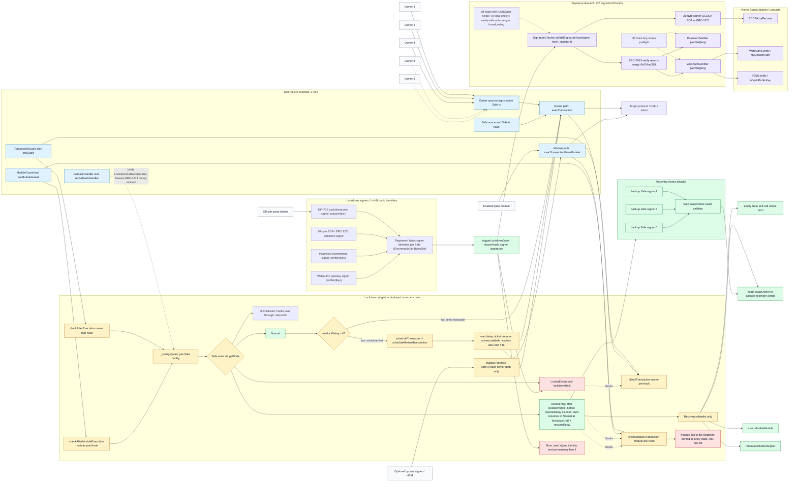
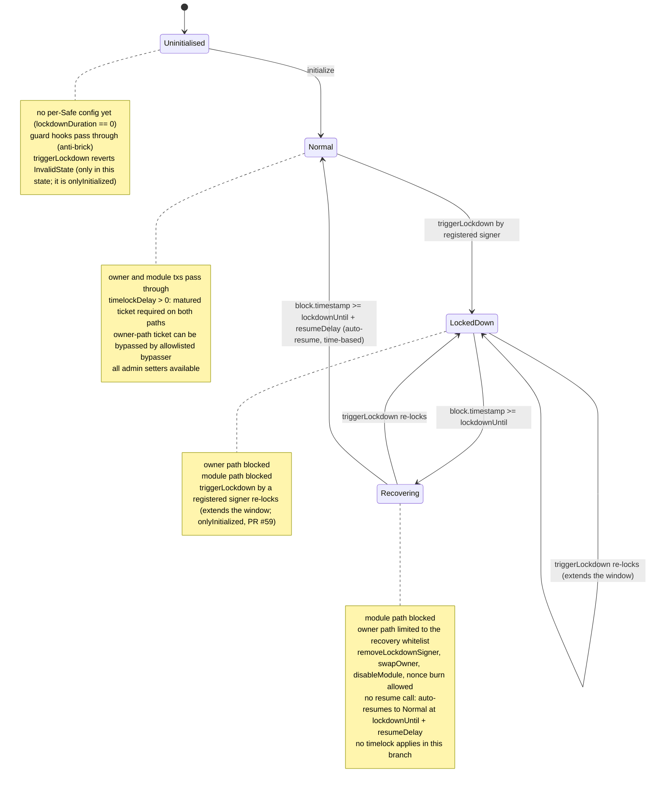

# Architecture Diagrams

This page contains source diagrams for the V1 Safe Lockdown architecture.
The Mermaid version is the audit-facing source of truth. The Excalidraw file is
the presentation-friendly map:

- `docs/safe-lockdown-architecture.excalidraw`

Rendered PNG exports live in `docs/diagrams/`:

- `diagrams/safe-lockdown-solidity-surface-mermaid.png` (Mermaid flowchart below)
- `diagrams/safe-lockdown-state-machine-mermaid.png` (Mermaid state machine below)
- `diagrams/safe-lockdown-architecture-excalidraw.png` (Excalidraw export)

To re-export the Mermaid blocks after editing this file (Chromium sandbox off
for headless environments):

```sh
echo '{"args":["--no-sandbox"]}' > /tmp/puppeteer-no-sandbox.json
awk '/^```mermaid/{n++; f="/tmp/diag" n ".mmd"; next} /^```$/{f=""} f{print > f}' docs/ARCHITECTURE_DIAGRAMS.md
npx --yes @mermaid-js/mermaid-cli -p /tmp/puppeteer-no-sandbox.json \
  -i /tmp/diag1.mmd -o docs/diagrams/safe-lockdown-solidity-surface-mermaid.png -w 2400 -s 3 -b white
npx --yes @mermaid-js/mermaid-cli -p /tmp/puppeteer-no-sandbox.json \
  -i /tmp/diag2.mmd -o docs/diagrams/safe-lockdown-state-machine-mermaid.png -w 1200 -b white
```

## Global Solidity Surface



## State Machine


